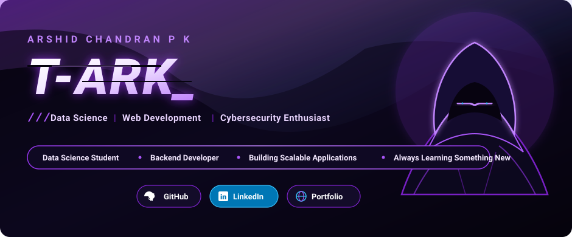
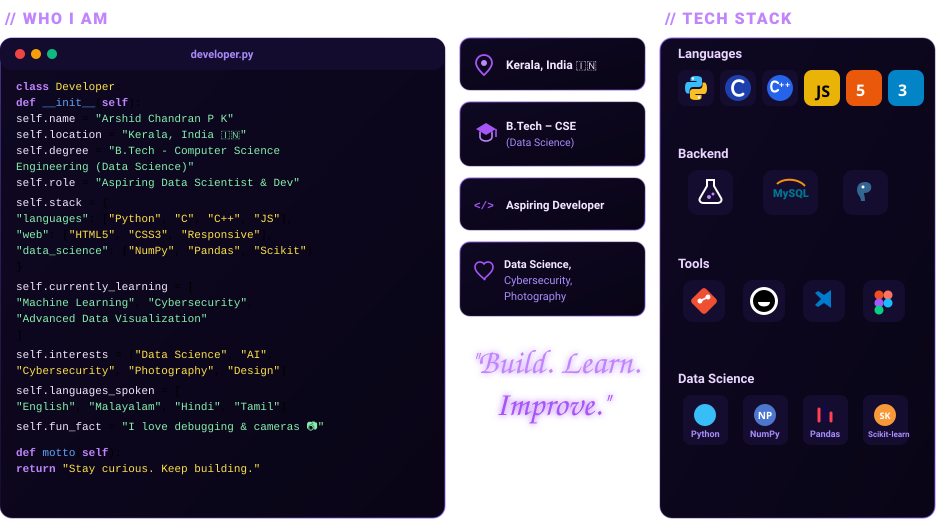
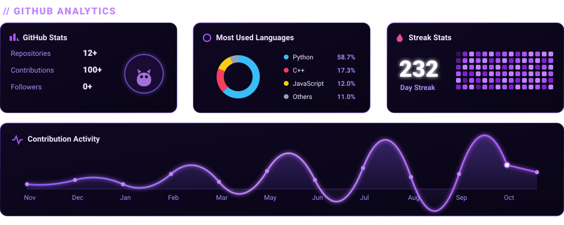
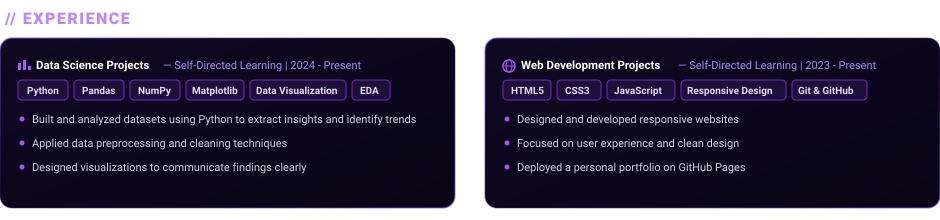

<div align="center">

<!-- ========================================== -->
<!-- 01. HERO BANNER                            -->
<!-- ========================================== -->
<a href="https://github.com/T-ARK">
  
</a>

<p align="center">
  <a href="https://github.com/T-ARK"></a> &nbsp;
  <a href="https://www.linkedin.com/in/arshid-chandran-p-k"></a> &nbsp;
  <a href="https://arshidchandranpk.netlify.app"></a>
</p>

<br>

<!-- ========================================== -->
<!-- 02. WHO I AM & TECH STACK                  -->
<!-- ========================================== -->


<br><br>

<!-- ========================================== -->
<!-- 03. GITHUB ANALYTICS                       -->
<!-- ========================================== -->


<br><br>

<!-- ========================================== -->
<!-- 04. EXPERIENCE                             -->
<!-- ========================================== -->


<br><br>

<!-- ========================================== -->
<!-- 05. FEATURED PROJECTS                      -->
<!-- ========================================== -->


<p align="center">
  <a href="https://arshidchandranpk.netlify.app"><code>[ 🌐 Personal Portfolio ]</code></a> &nbsp;•&nbsp;
  <a href="https://github.com/T-ARK"><code>[ 📊 Data Analysis Toolkit ]</code></a> &nbsp;•&nbsp;
  <a href="https://github.com/T-ARK"><code>[ 🏛️ Smart Banking System ]</code></a> &nbsp;•&nbsp;
  <a href="https://github.com/T-ARK"><code>[ 🗄️ SQL Migrator ]</code></a>
</p>

<br>

<!-- ========================================== -->
<!-- 06. FOOTER SECTION & UPLINK                -->
<!-- ========================================== -->


<p align="center">
  <a href="mailto:arshidchandranpk@gmail.com"></a> &nbsp;
  <a href="https://www.linkedin.com/in/arshid-chandran-p-k"></a> &nbsp;
  <a href="https://github.com/T-ARK"></a>
</p>

</div>

<br>

---

<details>
<summary><b>👾 Click to expand developer.py terminal source &amp; live stats</b></summary>

```python
class Developer:
    def __init__(self):
        self.name = "Arshid Chandran P K"
        self.location = "Kerala, India 🇮🇳"
        self.degree = "B.Tech - Computer Science Engineering (Data Science)"
        self.role = "Aspiring Data Scientist & Developer"
        
        self.stack = {
            "languages": ["Python", "C", "C++", "JavaScript"],
            "web": ["HTML5", "CSS3", "JavaScript", "Responsive Design"],
            "data_science": ["NumPy", "Pandas", "Matplotlib", "Scikit-learn"]
        }
        self.currently_learning = [
            "Machine Learning",
            "Cybersecurity & Ethical Hacking",
            "Advanced Data Visualization"
        ]
        self.interests = [
            "Data Science", "AI", "Cybersecurity",
            "Photography", "Design", "Creative Content"
        ]
        self.languages_spoken = ["English", "Malayalam", "Hindi", "Tamil"]
        self.fun_fact = "I find debugging code just as fun as editing photos 📷"
    
    def motto(self):
        return "Stay curious. Keep building. Never stop learning."
```

<div align="center">

#### Real-Time GitHub Telemetry

<table border="0">
  <tr>
    <td align="center">
      
    </td>
    <td align="center">
      
    </td>
  </tr>
</table>

<p align="center">
  
</p>

</div>

</details>

<div align="center">
  <sub><code>T-ARK // ARSHID CHANDRAN P K • 2026 • DESIGN | DEVELOP | DEFEND</code></sub>
</div>
