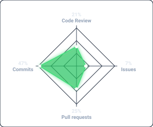
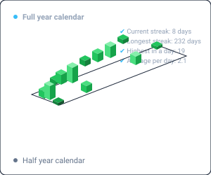
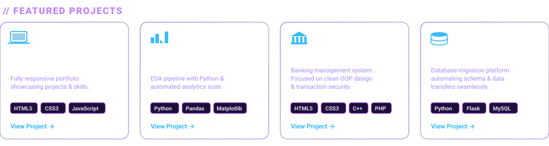

<!-- ═════════════ 1. NAME / HEADER (TRANSPARENT) ═════════════ -->

  
   
  

 

<!-- ═════════════ 2. TERMINAL (CELEFETCH & LOGO) + WHO I AM ═════════════ -->

  

 

<!-- ═════════════ 3. TECH STACK / STARRED TOPICS (TRANSPARENT) ═════════════ -->

  

 

<!-- ═════════════ 4. DYNAMIC STATS (100% TRANSPARENT BACKGROUNDS) ═════════════ -->

  <table border="0" style="background: transparent;">
    <tr style="background: transparent;">
      <td align="center" style="background: transparent; border: none;">
        
      </td>
      <td align="center" style="background: transparent; border: none;">
        
      </td>
    </tr>
  </table>

   

  

    

  

 

<!-- ═════════════ 5. 3D ISOMETRICS & ANIMATED 3D MODEL ═════════════ -->

  <table border="0" width="100%" style="background: transparent; border-collapse: collapse;">
    <tr style="background: transparent; border: none;">
      <td width="33%" align="center" style="background: transparent; border: none; padding: 4px;">
        
      </td>
      <td width="33%" align="center" style="background: transparent; border: none; padding: 4px;">
        
      </td>
      <td width="33%" align="center" style="background: transparent; border: none; padding: 4px;">
        
      </td>
    </tr>
  </table>

 

<!-- ═════════════ 6. FEATURED PROJECTS (TRANSPARENT) ═════════════ -->

  

  

    <a href="https://arshidchandranpk.netlify.app"><code>[ 🌐 Personal Portfolio Website ]</code></a> &nbsp;•&nbsp;
    <a href="https://github.com/T-ARK"><code>[ 📊 Data Analysis Toolkit ]</code></a> &nbsp;•&nbsp;
    <a href="https://github.com/T-ARK/Smart_Banking_System"><code>[ 🏛️ Smart Banking System ]</code></a> &nbsp;•&nbsp;
    <a href="https://github.com/sql-migrator-team/SQL-MIGRATOR"><code>[ 🗄️ SQL Migrator Platform ]</code></a>
  

 

<!-- ═════════════ 7. CONNECT & FOOTER ═════════════ -->

  

     &nbsp;
     &nbsp;
     &nbsp;
    
  

   

  
   
  

