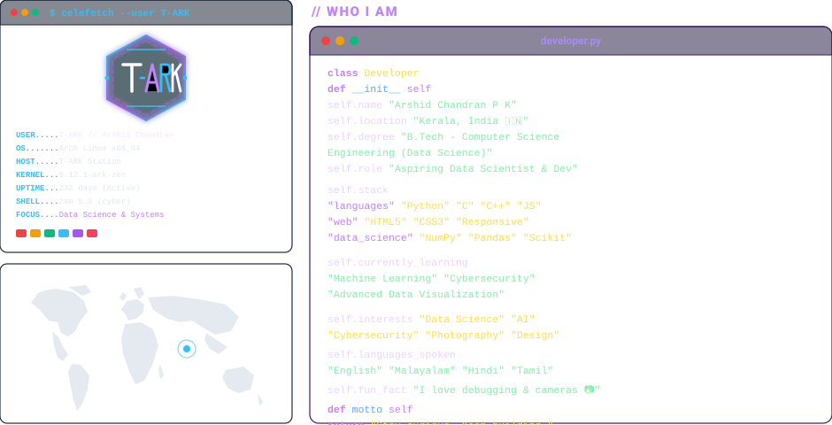
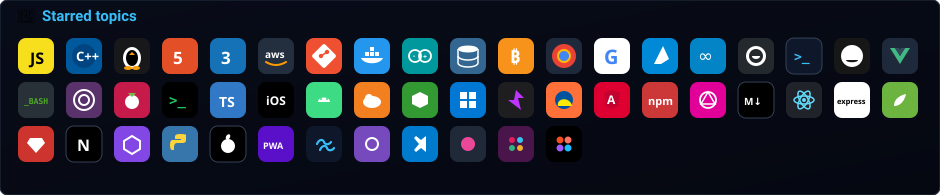
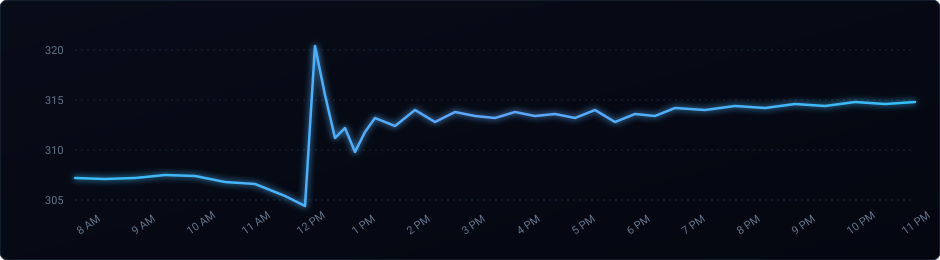
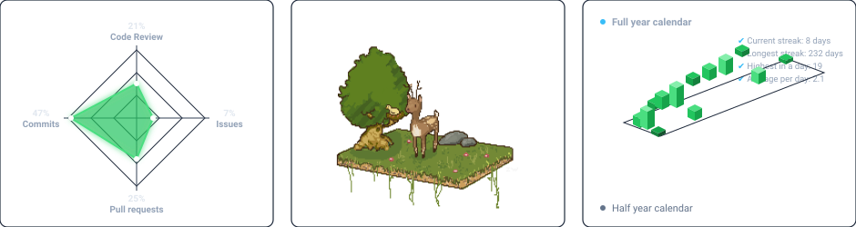

<div align="center">

<!-- ======================================================== -->
<!-- 01. TOP SECTION: $ celefetch + World Map + // WHO I AM   -->
<!-- ======================================================== -->


<br><br>

<!-- ======================================================== -->
<!-- 02. STARRED TOPICS: Tech & Tools Icons Matrix            -->
<!-- ======================================================== -->


<br><br>

<!-- ======================================================== -->
<!-- 03. TELEMETRY LINE CHART: Real-Time Activity Monitoring  -->
<!-- ======================================================== -->


<br><br>

<!-- ======================================================== -->
<!-- 04. METRICS & ART: Radar Chart, Isometric Island, 3D Cal -->
<!-- ======================================================== -->


<br><br>

<!-- ======================================================== -->
<!-- 05. FEATURED PROJECTS: 4 Interactive Project Cards       -->
<!-- ======================================================== -->


<p align="center">
  <a href="https://arshidchandranpk.netlify.app"><code>[ 🌐 Personal Portfolio Website ]</code></a> &nbsp;•&nbsp;
  <a href="https://github.com/T-ARK"><code>[ 📊 Data Analysis Toolkit ]</code></a> &nbsp;•&nbsp;
  <a href="https://github.com/T-ARK"><code>[ 🏛️ Smart Banking System ]</code></a> &nbsp;•&nbsp;
  <a href="https://github.com/T-ARK"><code>[ 🗄️ SQL Migrator Platform ]</code></a>
</p>

<br>

<!-- ======================================================== -->
<!-- CONNECT & SOCIAL UPLINKS                                 -->
<!-- ======================================================== -->
<p align="center">
  <a href="mailto:arshidchandranpk@gmail.com"></a> &nbsp;
  <a href="https://www.linkedin.com/in/arshid-chandran-p-k"></a> &nbsp;
  <a href="https://github.com/T-ARK"></a> &nbsp;
  <a href="https://arshidchandranpk.netlify.app"></a>
</p>

</div>

<br>

---

<details>
<summary><b>👾 Click to view full source code &amp; developer configuration</b></summary>

```python
class Developer:
    def __init__(self):
        self.name = "Arshid Chandran P K"
        self.location = "Kerala, India 🇮🇳"
        self.degree = "B.Tech - Computer Science Engineering (Data Science)"
        self.role = "Aspiring Data Scientist & Dev"

        self.stack = {
            "languages": ["Python", "C", "C++", "JS"],
            "web": ["HTML5", "CSS3", "Responsive"],
            "data_science": ["NumPy", "Pandas", "Scikit"],
        }
        self.currently_learning = [
            "Machine Learning",
            "Cybersecurity",
            "Advanced Data Visualization",
        ]
        self.interests = [
            "Data Science",
            "AI",
            "Cybersecurity",
            "Photography",
            "Design",
        ]
        self.languages_spoken = ["English", "Malayalam", "Hindi", "Tamil"]
        self.fun_fact = "I love debugging & cameras 📷"

    def motto(self):
        return "Stay curious. Keep building."
```

</details>

<div align="center">
  <sub><code>T-ARK // ARSHID CHANDRAN P K • 2026 • DESIGN | DEVELOP | DEFEND</code></sub>
</div>
