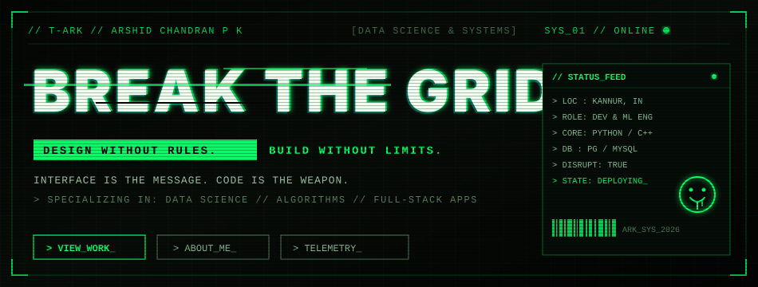

<div align="center">

<!-- Top Telemetry Header -->
<code>// T-ARK // ARSHID CHANDRAN P K &nbsp;&nbsp;|&nbsp;&nbsp; [SYS_01 :: ONLINE]</code>

<br><br>

<!-- Hero Banner Graphic -->
<a href="https://github.com/T-ARK">
  
</a>

<br>

<!-- Subtitle / Manifesto -->
<p align="center">
  <code><b>DESIGN WITHOUT RULES. BUILD WITHOUT LIMITS.</b></code><br>
  <code>INTERFACE IS THE MESSAGE. 2026_</code>
</p>

<!-- Quick Navigation Pill Bar -->
<p align="center">
  <a href="#-system-telemetry"><code>[ // SYS_INFO ]</code></a> &nbsp;•&nbsp;
  <a href="#-tech-arsenal"><code>[ // TECH_STACK ]</code></a> &nbsp;•&nbsp;
  <a href="#-selected-works"><code>[ // SELECTED_WORKS ]</code></a> &nbsp;•&nbsp;
  <a href="#-experiments-feed"><code>[ // EXPERIMENTS ]</code></a> &nbsp;•&nbsp;
  <a href="#-github-telemetry"><code>[ // TELEMETRY ]</code></a> &nbsp;•&nbsp;
  <a href="#-communication-uplink"><code>[ // UPLINK ]</code></a>
</p>

<p align="center">
  
  
  
</p>

</div>

<br>

---

### `// 01. SYSTEM_TELEMETRY`

```ascii
┌────────────────────────────────────────────────────────────────────────┐
│ // SYS_INFO                                                            │
│ > IDENTITY      : Arshid Chandran P K (T-ARK)                          │
│ > DESIGNATION   : Software Engineer & Data Science Practitioner        │
│ > BASE          : Kannur, Kerala // Connected to the Global Grid       │
│ > CORE FOCUS    : Machine Learning • Data Pipelines • Systems • Web    │
│ > STATUS        : Available for High-Impact Projects & Collaborations  │
│ > MOTTO         : "I don't follow trends. I create disruption."         │
└────────────────────────────────────────────────────────────────────────┘
```

> **`>` CREATING DIGITAL EXPERIENCES AND BACKEND ARCHITECTURES THAT CHALLENGE REALITY.**  
> Specializing in architecting robust database migration engines, algorithmic data structures, intelligent statistical pipelines, and modern interactive user experiences.

<br>

---

### `// 02. TECH_ARSENAL`

<div align="center">

#### `[ CORE_LANGUAGES ]`
<p>
  
  
  
  
  
  
</p>

#### `[ DATA_SCIENCE_&_ANALYTICS ]`
<p>
  
  
  
  
  
</p>

#### `[ BACKEND_&_DATABASES ]`
<p>
  
  
  
  
  
</p>

#### `[ FRONTEND_LAB_&_DEV_ENVIRONMENT ]`
<p>
  
  
  
  
  
  
</p>

</div>

<br>

---

### `// 03. _SELECTED WORK`

```
┌── [01] SQL DATABASE MIGRATOR ──────────────────────────────────────────┐
│ TYPE: DATA PIPELINE // SYSTEM UTILITY                                  │
│ STACK: Python • Flask • SQLAlchemy • MySQL • PostgreSQL • SQLite       │
│ DESC: Automated schema analysis, type mapping, and data migration      │
│       pipeline between heterogeneous relational database engines       │
│       with zero data-loss guarantees and real-time migration logs.     │
│ LINK: https://github.com/T-ARK                                         │
└────────────────────────────────────────────────────────────────────────┘

┌── [02] SMART BANKING SYSTEM ───────────────────────────────────────────┐
│ TYPE: ALGORITHMIC CORE // OBJECT-ORIENTED ENGINE                       │
│ STACK: C++ • OOP • Memory Management • File I/O Streams                │
│ DESC: High-integrity transaction ledger implementing strict security   │
│       checks, account balance reconciliations, audit logs, and         │
│       persistent storage structures without third-party bloat.         │
│ LINK: https://github.com/T-ARK                                         │
└────────────────────────────────────────────────────────────────────────┘

┌── [03] ANIMATED INTERACTIVE UI LAB ────────────────────────────────────┐
│ TYPE: WEB LAB // EXPERIMENTAL FRONTEND                                 │
│ STACK: HTML5 • CSS3 Keyframes • Modern Vanilla JS • Micro-interactions │
│ DESC: Cyberpunk and neo-brutalist inspired UI components, reactive     │
│       forms, fluid transitions, and dynamic visual states crafted      │
│       for seamless cross-device immersion.                             │
│ LINK: https://arshidchandranpk.netlify.app                             │
└────────────────────────────────────────────────────────────────────────┘

┌── [04] DATA ANALYTICS & STATISTICAL TELEMETRY ─────────────────────────┐
│ TYPE: MACHINE LEARNING // RESEARCH & EXPERIMENTS                       │
│ STACK: Python • NumPy • Pandas • Scikit-Learn • Jupyter Notebooks      │
│ DESC: Dimensionality reduction pipelines (PCA), cluster validation,   │
│       feature importance ranking, and statistical data modeling for    │
│       uncovering latent patterns in high-dimensional datasets.         │
│ LINK: https://github.com/T-ARK                                         │
└────────────────────────────────────────────────────────────────────────┘
```

<br>

---

### `// 04. //EXPERIMENTS_FEED`

```bash
$ telemetry --watch --stream=live
[SYSTEM_LOG] Initializing experimental modules...

> [01] datamosh_migrator.py      [COMPLETED]   2.4 MB  // Automated DB Transfer
> [02] broken_grid_layout.css    [COMPILED]    1.1 MB  // Neo-Brutalist CSS System
> [03] system_failure_debug.log  [RESOLVED]    3.7 MB  // Core Dump Analysis
> [04] pca_eigen_vectors.ipynb   [TRAINED]     4.3 MB  // Feature Space Compression

$ echo "INTERFACE IS THE MESSAGE."
>> OK: All nodes synchronized.
```

<br>

---

### `// 05. GITHUB_TELEMETRY`

<div align="center">

<table border="0">
  <tr>
    <td align="center">
      
    </td>
    <td align="center">
      
    </td>
  </tr>
</table>

<p align="center">
  
</p>

</div>

<br>

---

### `// 06. COMMUNICATION_UPLINK`

<div align="center">

<p>
  <br>
  <code><b>DESIGN IS REBELLION. CODE IS THE ENGINE.</b></code><br>
  <code>LET'S BREAK SOMETHING TOGETHER.</code>
</p>

<p align="center">
  <a href="https://arshidchandranpk.netlify.app" target="_blank">
    
  </a>
  &nbsp;
  <a href="https://www.linkedin.com/in/arshid-chandran-p-k" target="_blank">
    
  </a>
  &nbsp;
  <a href="https://github.com/T-ARK" target="_blank">
    
  </a>
  &nbsp;
  <a href="mailto:arshidchandranpk@gmail.com">
    
  </a>
</p>

<br>

```
||| | ||||| | ||| |||||| | | |||||||| |||| | ||| ||||
                 D3V_T_ARK_2026 // END_TRANSMISSION
```

</div>
